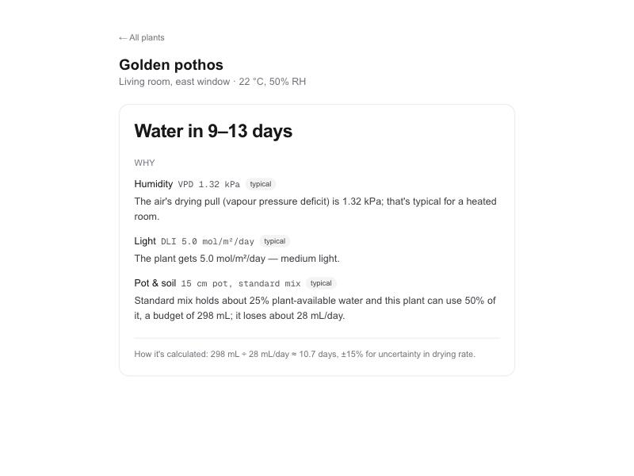

# Annotated Claude Code session log

One Claude Code session (desktop app, Code tab, model Claude Opus 5.5) took the project from an empty folder
to the current state. Entries are condensed from the transcript: **▶ prompt/tool call**, then
**→ result**, then a 💬 note on why it matters. Commit hashes link each step to `git log`.

Section 4b is Chenxi's review-and-verify session, and the section 5 screenshots come from Chenxi's terminal
session (`claude` in the repo folder), because the desktop app manages context itself.

---

## 0. Setup

| # | Step | Result | 💬 Note |
|---|---|---|---|
| S1 | ▶ Prompt: *"do this assignment according to our project proposal"*, with the HW4 PDF and the proposal attached | Claude read the PDF, checked for Node (`which node` → not found) and asked two questions: download Node? which repo folder? | Asking before downloading anything is the permission model working as intended. |
| S2 | ▶ `curl` Node 22.23.5 + `shasum -a 256 -c` against `SHASUMS256.txt` | `node-v22.23.5-darwin-arm64.tar.gz: OK` | Installed to `~/.local/node`, no sudo. Later recorded in CLAUDE.md, because the commands `/init` generated fail without that PATH. |
| S3 | ▶ `npx create-next-app@16.4.6 … --src-dir --tailwind` | Next 16.4.6 / React 19.3 scaffold + `AGENTS.md` | `AGENTS.md` warns that Next 16 differs from the model's training data, which shaped the Explore phase later. |
| S4 | ▶ `npm i -D vitest@3 … stryker@9` → `npm audit` | **3 critical** (tinypool RCE) | ⚠️ The first version choice was out of date. Re-checked `npm view … dist-tags`, moved to vitest 5.1.1 / Stryker 10.1.1 / `@types/node@22` (fixed an ERESOLVE peer conflict). 5 moderate dev-only issues remain. |
| | **commit** `28ee1bb chore: add Vitest, fast-check and Stryker test tooling` | | |

## 1. Part 1: `/init` and CLAUDE.md iteration

| # | Step | Result | 💬 Note |
|---|---|---|---|
| P1 | ▶ `/init` | Claude read `README.md`, `package.json`, `tsconfig.json`, `eslint.config.mjs`, `next.config.ts`, and checked for Cursor/Copilot/Codex rules (found `~/.codex/config.toml`; it offers `/import` instead of reading it) | `/init` gives a starting file from the scaffold, not a finished one; P2–P3 show what we added. |
| P2 | → generated CLAUDE.md: 20 lines covering commands, App Router, the `@/*` alias and `cacheComponents` | `065f9c4`, snapshot `docs/claude-md-history/01-init-output.md` | Accurate but generic. It knew nothing about plants, TDD or the pure-model rule. |
| P3 | ▶ Iterate: write `docs/PRD.md` and `docs/model-science.md`, add `@docs/PRD.md`, `@docs/model-science.md`, `@AGENTS.md` imports, plus architecture decisions, unit-suffixed names, testing strategy, do's/don'ts and context habits | `59791ae`, snapshot `02-iterated.md` | The `@imports` mean every new session starts out knowing the stories and equations. |
| P4 | ▶ `.claude/settings.json`: allow test/lint/typecheck/git; ask for installs, push, reset and `package.json`/`CLAUDE.md` edits; deny `.env*`, `curl`/`wget`/WebFetch, `rm -rf`, force-push; sandbox on | same commit | The deny list blocks the risky actions an agent could take without asking. Edits to the rules file itself require asking. |

## 2. Part 3: strict TDD on the watering model (story 1)

The acceptance criteria were written first in `docs/features/watering-prediction.md`. Each cycle went: write the
test, run it and watch it fail, commit **red**, write the minimum code, commit **green**, refactor with the tests
green, commit **refactor**.

| AC | red | green | refactor | 💬 What happened |
|---|---|---|---|---|
| AC1 VPD | `875a420` (Cannot find module) | `e3b0eb5` 5/5 | `7354a0a` | ⚠️ The first refactor also added a NaN test and `Number.isFinite`, which is new behaviour. Claude caught this, removed it from the refactor and gave it its own cycle: red `b6cc7bc` (2 failing) → green `4949f98`. |
| AC2 DLI | `7517411` | `8a9e6f4` | `ad86412` | fast-check linearity property. |
| AC3 pot | `14a0512` | `711fd52` | `9cd0744` | Exported the soil/depletion tables so story 2 could quote them. |
| AC4 loss | `e63da34` | `25ad013` | `4a74a5a` | Monotonicity properties. |
| AC5 predict | `4a928e2` | `88d2259` | `b0041b2` | ⚠️ **Design change before red:** a ±25 % band gave the pothos 8–15 days, too wide to act on, so it was narrowed to ±15 % and the docs were updated. ⚠️ **False red:** after green, 1 test still failed (`expected 0.29820… to be close to 0.2983`). The cause was hand-rounded arithmetic in the test, not the code. Claude recomputed the value in Python and noted the correction in the green commit message. |
| capped | `aa89b5f` (2 failing) | `dc6c952` | — | Same rule as AC1: `capped` was drafted inside the refactor, then pulled out into its own cycle. |
| mutation | — | — | `b620c8f` | ▶ `npx stryker run` → **97.37 %**, 2 survivors (`-10 → +10` on the minimum temperature; empty `potDiameterCm` message). Tests were added to kill both → **100 %**. |

## 3. Part 2: Explore → Plan → Implement → Commit (story 2, "why this date")

| Phase | Tool calls | Output |
|---|---|---|
| **Explore** | `find node_modules/next/dist/docs -iname "*cache*component*"` (Glob); `grep -n params …layouts-and-pages.md`; Read `cacheComponents.md`, `migrating-to-cache-components.md` §generateStaticParams; Read `src/app/page.tsx`, `layout.tsx`; `grep -rn "^export" src/lib/model` | Findings in `docs/features/why-explanation.md`: `params` is a Promise; `generateStaticParams` must return ≥ 1 param; the model already exposes all factors. **commit `4d158e7`** |
| **Plan** | `EnterPlanMode` → plan written to the plan file → `ExitPlanMode` → **user approved** | Plan copied to `docs/plans/why-explanation-plan.md`. **commit `a2b5236`** |
| **Implement** | TDD for the pure explain layer (red `f26944c` → green `76f4cbc` → refactor `4a7eef9`); sample plants `a9ff80b`; `WhyCard` + `/plants/[id]` `7ce4fb7`; home list `9d16918` | ⚠️ `tsc` failed: `'"/plants/[id]"' does not satisfy the constraint '"/"'`. Route types are generated, so the fix was `next typegen`, and `typecheck` now runs it first. |
| **Verify** | `npm run build` (prerendered `/plants/pothos`, `/calathea`, `/snake-plant`); `next start` + browser pane: `/` lists 9–13 / 10–14 / 9–13 days; `/plants/pothos` shows all three reasons with numbers; `/plants/nope` gives a 404 | 📸 [`/plants/pothos`](screenshots/plants-pothos.jpg), below |
| **Commit (fix)** | The browser check showed "standard mix holds…" in lowercase, so a red/green cycle fixed it: `081f657` → `8eeb78e` | ⚠️ `git add -A` swept in `.claude/launch.json` (a machine-specific path); `51502ef` untracks it and gitignores it. |
| **Iterate CLAUDE.md** | Lessons from the mistakes above added to CLAUDE.md | `51502ef`, snapshot `03-after-features.md` |

## 4. Final state
- 36 commits; 42 tests (example + fast-check property tests); Stryker 100 % on `src/lib/model`.
- `npm test && npm run typecheck && npm run lint && npm run build` all pass.

## 4b. Partner check (Chenxi's Claude Code session, 2026-11-25)

| # | Step | Result | 💬 Note |
|---|---|---|---|
| C1 | ▶ Read the repo on GitHub against the HW4 rubric (`gh api` tree, commits, CLAUDE.md, session log) | Parts 1–3 covered; missing: context-command evidence, `/plants/pothos` screenshot, reflection placeholders | Reviewing the work against the rubric before adding to it. |
| C2 | ▶ Fresh clone, `npm ci`, `npm test`, `npm run typecheck`, `npm run lint`, `npm run build` | 42/42 tests pass; typecheck, lint and build clean | Confirms the work reproduces on a second machine (Node 24), not only on the machine that wrote it. |
| C3 | ▶ `next start` + browser pane → `/plants/pothos` | Screenshot above: 9–13 days, VPD 1.32 kPa, DLI 5.0, 298 mL budget, 28 mL/day | Fills the Verify evidence slot. |
| C4 | ▶ Reflection placeholders filled from Chenxi's answers (previous workflow, cost, what we'd do differently) | `docs/reflection.md` | Claude asked instead of inventing our experience. |

## 5. Context management (📸 run these yourselves and paste the output)

| Command | When we use it | 📸 Evidence |
|---|---|---|
| `/clear` | Between unrelated tasks, e.g. after the TDD model work and before starting the story-2 UI. The `@imports` in CLAUDE.md reload the PRD and science notes, so nothing important is lost. | 📸 [context-3-clear.png](screenshots/context-3-clear.png): after `/clear`, "what are the user stories?" was answered from the imported PRD in 4 s, with no file reads. |
| `/compact Keep: current AC, failing test name, files touched` | When a long TDD session approaches the context limit | 📸 [before](screenshots/context-1-before-compact.png) · [after](screenshots/context-2-compact.png): "Compacted", then Claude Code re-read `docs/model-science.md`, `docs/PRD.md` and `AGENTS.md` on its own. |
| `claude --continue` | Resuming after a break: `cd plant-care-project3 && claude --continue`, then "where did we leave off?" | 📸 [context-4-where-left-off.png](screenshots/context-4-where-left-off.png): after exiting and running `claude --continue`, "where did we leave off?" got a done / still-open list built from git and the docs. |

In this desktop session, the app compacts context automatically. The project's durable memory is CLAUDE.md plus `docs/`, not the chat.
